# Algorithm processing flow

This diagram follows `MemeticNSGA2Selector.fit()` from development data to
saved results. A feature subset is a Boolean mask over the validated predictor
columns. The two search objectives are **negative mean validation Gini** and
**selected feature count**; segment constraints, when supplied, restrict which
subsets are feasible.

```mermaid
flowchart TD
    A["1. Read settings and validate development data"] --> B["2. Build complete chronological CV folds"]
    B --> C["3. Persist normalized data and fold positions"]
    C --> D["4. Calibrate on the full-feature reference"]
    D --> E{"5. RFE initialization enabled?"}
    E -- Yes --> F["5a. Remove low-gain features and evaluate RFE checkpoints"]
    E -- No --> G["6. Assemble the initial subset population"]
    F --> G
    G --> H["7. Choose this generation's evaluation fidelity"]
    H --> I{"8. Did fidelity change?"}
    I -- Yes --> J["8a. Reevaluate surviving parents on the new fold basis"]
    I -- No --> K["9. Create candidate subsets with NSGA-II"]
    J --> K
    K --> L["10. Evaluate candidates and segment constraints"]
    L --> M["11. Apply constrained NSGA-II survival"]
    M --> N{"12. Reduced-fold generation?"}
    N -- Yes --> O["12a. Confirm provisional frontier candidates on full CV"]
    N -- No --> P{"13. Local-search interval reached?"}
    O --> P
    P -- Yes --> Q["13a. Propose and evaluate local neighbors; apply survival"]
    P -- No --> R["14. Update confirmed frontier and hypervolume"]
    Q --> R
    R --> S["15. Record history and checkpoint"]
    S --> T{"16. Continue searching?"}
    T -- Yes --> H
    T -- No --> U["17. Confirm every final survivor on full CV"]
    U --> V["18. Select from feasible confirmed Pareto candidates"]
    V --> W["19. Export tables, report, and final checkpoint"]
    W -. Optional call .-> X["Fit final LightGBM model on all development rows"]
```

## What each step does

1. **Validate inputs.** Convert `X` to a predictor matrix, separate the target,
   time, IDs, and segment metadata, check binary labels and row alignment, and
   enforce the inclusive feature-count bounds and typed settings.
2. **Build folds.** Normalize dates to observed month ordinals. Build expanding
   monthly folds or validate custom folds; each interval includes every eligible
   row, training precedes validation, and validation windows do not overlap.
3. **Persist inputs.** Save the normalized data and exact fold row positions for
   workers and restart. Fingerprints and file hashes guard against changed data.
4. **Calibrate the reference.** Evaluate all predictors with fixed-round,
   deterministic CPU LightGBM on full CV. Record fold and segment metrics,
   feature gain, and measured memory for resource planning.
5. **Optional RFE seeds.** If enabled, remove batches of low-gain features and
   evaluate each removal step on full CV. Retain subsets at requested feature
   counts as population seeds; otherwise skip this step.
6. **Initialize the population.** Combine validated user seeds, RFE seeds,
   importance-ranked and feature-family subsets, and random subsets sampled
   across permitted cardinalities. Discard duplicate masks.
7. **Choose fidelity.** Early generations can use the last configured number
   of complete chronological folds (`last_N`); later generations use every
   canonical fold (`full`). Reduced-fold results are provisional.
8. **Align parent evaluations.** When fidelity changes, reevaluate surviving
   parents on the new fold basis before they compete with offspring.
9. **Generate candidates.** NSGA-II uses two-point binary crossover, guided or
   random feature mutations, cardinality repair, and duplicate elimination.
   Add, remove, swap, and optional family-guided exchanges keep masks within
   `feature_range`.
10. **Evaluate candidates.** Memory-aware workers fit LightGBM separately on
    each selected fold's full training rows and score all validation rows.
    They cache completed evaluations by data, settings, mask, and fidelity;
    calculate mean fold Gini and feature count; and compare eligible segment
    Gini against the full-feature reference on each fold.
11. **Select survivors.** pymoo ranks feasible and infeasible candidates using
    constraint-aware nondominated sorting and crowding, then keeps the next
    population. Feasible objectives minimize `(-mean_gini, n_features)`.
12. **Confirm provisional candidates.** After a reduced-fold generation,
    evaluate its provisional Pareto front on full CV. If no provisional
    candidate is feasible, confirm the least-violating candidates instead.
13. **Refine locally.** At configured intervals, propose a bounded set of
    distinct neighbors around confirmed frontier subsets. Evaluate them on
    full CV; when the population is provisional, also evaluate them on its
    current fold basis before survival.
14. **Update the frontier.** Keep unique, feasible, nondominated full-CV
    results in the confirmed Pareto archive. Compute normalized hypervolume
    from that archive only, using fixed Gini and feature-count bounds.
15. **Record progress.** Append one history row with fidelity, frontier and
    population metrics, then save the optimizer state and random-generator
    states. Completed candidate evaluations are also durable in SQLite.
16. **Check stopping.** Continue until the generation limit, the configured
    number of stalled hypervolume generations after the minimum, exhaustion
    of distinct offspring, or a safe cancellation boundary.
17. **Confirm final survivors.** Evaluate every final population member on
    full CV, including infeasible provisional survivors, and update the final
    confirmed frontier and last history row.
18. **Choose a model.** Select a feasible confirmed candidate using tolerance,
    statistical, or knee policy. With manual policy, wait for
    `select("manual", candidate_id=...)`.
19. **Export results.** Save the frontier, diagnostics, history, feature
    frequencies, tables, report, and checkpoint. A separate optional
    `fit_final_model()` call refits the chosen features on all development rows;
    it does not score external data.

On `MemeticNSGA2Selector.resume(...)`, the package verifies the saved manifest,
data, dependency versions, and evaluator identity, then restores the last
completed generation's population and random states. Completed cached
evaluations are reused. An interrupted generation may replay from its last
checkpoint.

See [optimization.md](optimization.md) for search details,
[validation.md](validation.md) for temporal-fold rules, and
[output-tables.md](output-tables.md) for result-column meanings.
